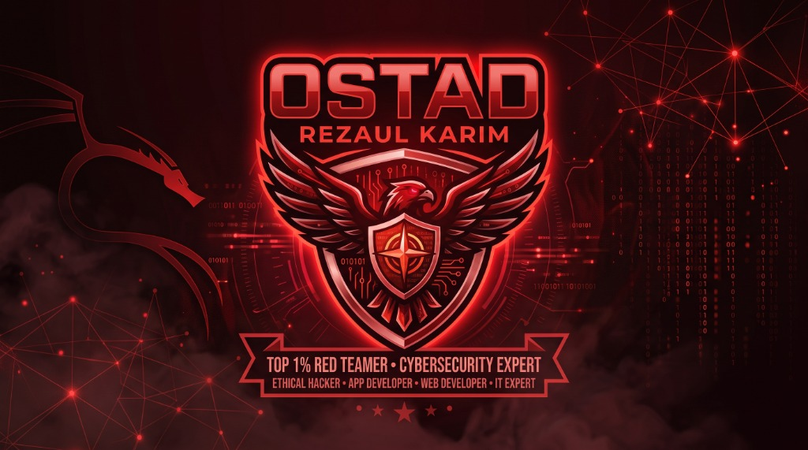

<p align="center">
  
</p>

<h1 align="center">📖 OstadRESpy ও OstadBitDiff - সম্পূর্ণ ব্যবহারকারী সহায়িকা ও সাইবার আত্মরক্ষা হ্যান্ডবুক</h1>

<p align="center">
  <b>Android, Windows, macOS ও Linux-এ যেকোনো ফাইল পুঙ্খানুপুঙ্খ ব্যবচ্ছেদ, ম্যালওয়্যার শনাক্তকরণ এবং সাইবার ক্ষতি থেকে বাঁচার পূর্ণাঙ্গ নির্দেশিকা</b><br>
  <i>Author: <b>Ostad Rezaul Karim</b> • Director & Founder, <b>Ostad Red Team Forge</b> • Email: <b>ostadrezaulkarimofficial@gmail.com</b></i>
</p>

---

## 📑 সূচিপত্র (Table of Contents)

1. [কোথায় কোন ফাইল রাখতে হবে ও ফোল্ডার বিন্যাস](#১-কোথায়-কোন-ফাইল-রাখতে-হবে-ও-ফোল্ডার-বিন্যাস)
2. [চারটি প্রধান প্ল্যাটফর্মে ব্যবহারের বিস্তারিত নিয়ম](#২-চারটি-প্রধান-প্ল্যাটফর্মে-ব্যবহারের-বিস্তারিত-নিয়ম)
   * [📱 ১. অ্যান্ড্রয়েড মোবাইল ফোনে সরাসরি যাচাই (Termux)](#-১-অ্যান্ড্রয়েড-মোবাইল-ফোনে-সরাসরি-যাচাই-termux)
   * [💻 ২. উইন্ডোজ কম্পিউটারে ব্যবহার (Windows 1-Click Drag & Drop)](#-২-উইন্ডোজ-কম্পিউটারে-ব্যবহার-windows)
   * [🍎 ৩. অ্যাপল ম্যাক কম্পিউটারে ব্যবহার (macOS)](#-৩-অ্যাপল-ম্যাক-কম্পিউটারে-ব্যবহার-macos)
   * [🐧 ৪. লিনাক্স ও কালি লিনাক্সে ব্যবহার (Linux / Kali)](#-৪-লিনাক্স-ও-কালি-লিনাক্সে-ব্যবহার-linux--kali)
3. [কোন তথ্য আসলে ক্ষতিকর (DANGEROUS) বনাম ক্ষতিকর নয় (SAFE)](#৩-কোন-তথ্য-আসলে-ক্ষতিকর-dangerous-বনাম-ক্ষতিকর-নয়-safe)
   * [অ্যান্ড্রয়েড APK ফাইলের সংকেত](#ক-অ্যান্ড্রয়েড-apk-ফাইলের-সংকেত)
   * [উইন্ডোজ EXE / DLL ফাইলের সংকেত](#খ-উইন্ডোজ-exe--dll-ফাইলের-সংকেত)
   * [লিনাক্স ও ম্যাক বাইনারি সংকেত](#গ-লিনাক্স-ও-ম্যাক-বাইনারি-সংকেত)
   * [স্ক্রিপ্ট ও ডকুমেন্টের সংকেত](#ঘ-স্ক্রিপ্ট-ও-ডকুমেন্টের-সংকেত)
4. [OstadRESpy ঠিক কত ধরনের তথ্য বের করে দেয়](#৪-ostadrespy-ঠিক-কত-ধরনের-তথ্য-বের-করে-দেয়)
5. [OstadBitDiff: দুটি ফাইলের তুলনা ও ট্রোজান ব্যাকডোর খোঁজার নিয়ম](#৫-ostadbitdiff-দুটি-ফাইলের-তুলনা-ও-ট্রোজান-ব্যাকডোর-খোঁজার-নিয়ম)
6. [হাতে-কলমে প্র্যাকটিস ল্যাব](#৬-হাতে-কলমে-প্র্যাকটিস-ল্যাব)
7. [নিজেকে বাঁচানোর গোল্ডেন রুলস ও ইমার্জেন্সি রেসপন্স](#৭-নিজেকে-বাঁচানোর-গোল্ডেন-রুলস-ও-ইমার্জেন্সি-রেসপন্স)

---

## ১. কোথায় কোন ফাইল রাখতে হবে ও ফোল্ডার বিন্যাস

আপনার কম্পিউটারে বা ফোনে ফাইলগুলো এভাবে সাজানো থাকবে:

```
📁 Extaracting App/             <-- মূল প্রজেক্ট ফোল্ডার
│
├── 📜 ostadrespy.py            <-- মূল সার্বজনীন ইঞ্জিন (সব ওএস-এর জন্য)
├── [+] ostadbitdiff.py          <-- বাইনারি ডিফারেন্সিয়াল ও ট্রোজান হান্টার
├── ⚙️ run_ostadrespy.bat       <-- উইন্ডোজের জন্য সিঙ্গেল ফাইল ড্র্যাগ-অ্যান্ড-ড্রপ লঞ্চার
├── ⚙️ run_bitdiff.bat          <-- উইন্ডোজের জন্য দুটি ফাইল ড্র্যাগ-অ্যান্ড-ড্রপ লঞ্চার
├── 🐧 run_ostadrespy.sh        <-- লিনাক্স ও ম্যাকের লঞ্চার
├── 🐧 run_bitdiff.sh           <-- লিনাক্স ও ম্যাকের ডিফ লঞ্চার
├── 📱 run_on_android.sh        <-- অ্যান্ড্রয়েড ফোনের জন্য Termux লঞ্চার
├── 📱 run_bitdiff_android.sh   <-- অ্যান্ড্রয়েড ফোনের জন্য Termux ডিফ লঞ্চার
├── 📋 requirements.txt         <-- ডিপেন্ডেন্সি ফাইল
├── 🖼️ logo.jpg                 <-- আপনার অফিশিয়াল লোগো
│
├── 📦 [টার্গেট ফাইল]           <-- যে ফাইলটি পরীক্ষা করবেন (যেমন: base.apk, virus.exe, doc.pdf)
│                                  এখানে রাখতে পারেন বা অন্য ফোল্ডারের পাথ দিতে পারেন।
│
├── 📄 OstadRESpy_AUDIT_REPORT.md   <-- স্ক্যান শেষে স্বয়ংক্রিয়ভাবে তৈরি হওয়া রিপোর্ট
└── 📄 OstadBitDiff_REPORT.md       <-- দুটি ফাইল ডিফ করার পর তৈরি হওয়া রিপোর্ট
```

> **সহজ নিয়ম:** আপনি যে ফাইলটি পরীক্ষা করতে চান, সেটি সরাসরি এই ফোল্ডারের ভেতরে এনে রেখে দিতে পারেন।

---


---

## 🎨 OstadRESpy সাইবারপাঙ্ক গ্রাফিক্যাল ইউজার ইন্টারফেস (Modern Futuristic Cyberpunk GUI)

সাধারণ মানুষ ও প্রফেশনাল সবার জন্য কমান্ড লাইনের পাশাপাশি একটি অত্যন্ত দৃষ্টিনন্দন, চোখ জুড়ানো ও হৃদয়গ্রাহী **সাইবারপাঙ্ক ফরেনসিক HUD (Heads-Up Display)** ড্যাশবোর্ড তৈরি করা হয়েছে। 

```
+-----------------------------------------------------------------------------------------+
|                  OstadRESpy Futuristic Cyberpunk HUD Features                           |
+-----------------------------------------------------------------------------------------+
|  [[+] Matrix Canvas]       --> ফ্লুয়িড পার্টিকেল ও হেক্সাগন গ্রিড ব্যাকগ্রাউন্ড             |
|  [🎯 Drag & Drop Zone]   --> যেকোনো ফাইল মাউস দিয়ে টেনে ছেড়ে দিলে তাৎক্ষণিক স্ক্যান      |
|  [🎛️ Radial Threat Dial]  --> ০ থেকে ১০০ পর্যন্ত রঙিন অ্যানিমেটেড থ্রেট মিটার (SVG)         |
|  [📊 10-Layer Live Cards]--> ১০টি ডিফেন্স ইঞ্জিনের রিয়েল-টাইম স্ট্যাটাস ও ডিটেইলস          |
|  [[+] Matrix Live Terminal]--> হ্যাকার-স্টাইল গ্রিন টাইপরাইটার লাইভ অডিট লগ                   |
|  [[+] OstadBitDiff Mode]   --> ১-ক্লিকে সুইচ করে দুটি ফাইলের ব্যবচ্ছেদ ও ট্রোজান হান্টিং       |
|  [📥 1-Click Export]     --> এক ক্লিকে সম্পূর্ণ Markdown রিপোর্ট ও Frida স্ক্রিপ্ট ডাউনলোড   |
+-----------------------------------------------------------------------------------------+
```

### 📱💻 চার প্রকার ডিভাইসের জন্য এক্সিকিউটেবল ও চালানোর নিয়ম:

#### ১. 📱 অ্যান্ড্রয়েড মোবাইল ও ট্যাবলেট (Android Users)
* **পদ্ধতি ১: সরাসরি APK ইনস্টল (`OstadRESpy-Dashboard.apk`):**
  * ফোল্ডারে থাকা **`OstadRESpy-Dashboard.apk`** ফাইলটি আপনার ফোনে পাঠিয়ে দিন এবং ট্যাপ করে ইনস্টল করুন। এটি যেকোনো অ্যান্ড্রয়েড ভার্সনে (Android 8 থেকে Android 15+) কোনো এরর ছাড়াই চলবে।
* **পদ্ধতি ২: প্রগ্রেসিভ ওয়েব অ্যাপ (PWA - ১-ট্যাপ হোমস্ক্রিন অ্যাপ):**
  * ফোন থেকে ড্যাশবোর্ড ওপেন করলে ব্রাউজারের নিচে স্বয়ংক্রিয়ভাবে প্রম্পট আসবে **"Add OstadRESpy to Home screen"** বা **"Install App"**। ট্যাপ করলেই এটি একটি আসল অ্যাপের মতো ফুল-স্ক্রিন মোডে ইনস্টল হয়ে যাবে।
* **পদ্ধতি ৩: টারমাক্স (Termux 1-Click):**
  ```bash
  bash run_android_gui.sh
  ```
  এটি সাথে সাথে ইঞ্জিনের ব্যাকএন্ড অন করে ফোনের ব্রাউজারে সাইবারপাঙ্ক ড্যাশবোর্ড খুলে দেবে।

---

#### ২. 💻 উইন্ডোজ কম্পিউটার ও ল্যাপটপ (Windows Users)
* **পদ্ধতি ১: সরাসরি এক্সিকিউটেবল ফাইল (`OstadRESpy.exe`):**
  * ফোল্ডারে থাকা **`OstadRESpy.exe`** ফাইলটিতে ডাবল ক্লিক করুন! কোনো পাইথন ইনস্টল করারও দরকার নেই। এটি সাথে সাথে একটি স্বয়ংসম্পূর্ণ প্রসেস হিসেবে চালু হয়ে ব্রাউজারে ড্যাশবোর্ড লোড করবে।
* **পদ্ধতি ২: ১-ক্লিক ব্যাচ ফাইল (`run_gui_windows.bat`):**
  * মাউস দিয়ে **`run_gui_windows.bat`**-এ ডাবল ক্লিক করলেই সম্পূর্ণ ড্যাশবোর্ড চালু হয়ে যাবে।

---

#### ৩. 🐧 লিনাক্স ও কালি লিনাক্স (Linux Users)
* **পদ্ধতি ১: লিনাক্স রান ফাইল (`OstadRESpy-Linux.run`):**
  * টার্মিনালে লিখুন:
    ```bash
    chmod +x OstadRESpy-Linux.run
    ./OstadRESpy-Linux.run
    ```
* **পদ্ধতি ২: লিনাক্স ডেক্সটপ মেন্যু শর্টকাট (`OstadRESpy.desktop`):**
  * Kali Linux বা Ubuntu-এর অ্যাপ্লিকেশন মেন্যুতে যুক্ত করতে ফাইলটি ডাবল ক্লিক করুন বা রান স্ক্রিপ্ট ব্যবহার করুন:
    ```bash
    bash run_linux_gui.sh
    ```

---

#### ৪. 🍎 অ্যাপল ম্যাক কম্পিউটার (macOS Users)
* **পদ্ধতি ১: ম্যাক অ্যাপ্লিকেশন বান্ডেল (`OstadRESpy.app`):**
  * **`OstadRESpy.app`** ফোল্ডারটিকে ম্যাকের `/Applications` ডিরেক্টরিতে ড্র্যাগ করুন বা সরাসরি ডাবল ক্লিক করুন।
* **পদ্ধতি ২: ডাবল-ক্লিক কমান্ড ফাইল (`OstadRESpy-Mac.command`):**
  * ম্যাকের ফাইন্ডারে গিয়ে **`OstadRESpy-Mac.command`** ফাইলে ডাবল ক্লিক করলেই সাথে সাথে সাফারি/ক্রোমে ড্যাশবোর্ড ওপেন হবে।
* **পদ্ধতি ৩: টার্মিনালে:**
  ```bash
  chmod +x run_mac_gui.sh
  ./run_mac_gui.sh
  ```

## ২. চারটি প্রধান প্ল্যাটফর্মে ব্যবহারের বিস্তারিত নিয়ম

---

### 📱 ১. অ্যান্ড্রয়েড মোবাইল ফোনে সরাসরি যাচাই (Termux)
*কম্পিউটার ছাড়াই আপনার হাতে থাকা ফোনটিতে ডাউনলোড করা যেকোনো অ্যাপ বা ফাইল ইনস্টল করার আগেই এক নিমিষে পরীক্ষা করুন:*

#### ধাপ ১: টারমাক্স সেটআপ
1. আপনার ফোনে **F-Droid** বা GitHub থেকে **Termux** ইনস্টল করুন।
2. টারমাক্স ওপেন করে লিখুন:
   ```bash
   pkg update -y && pkg install git python clang -y
   ```
3. ফোনের স্টোরেজ পারমিশন দিন:
   ```bash
   termux-setup-storage
   ```

#### ধাপ ২: OstadRESpy ফোল্ডারে প্রবেশ
```bash
git clone https://github.com/YOUR_USERNAME/OstadRESpy.git
cd OstadRESpy
```

#### ধাপ ৩: যেকোনো ফাইল স্ক্যান করা
ধরুন আপনি ইন্টারনেট থেকে `game.apk` ডাউনলোড করেছেন, যা আপনার ফোনের Download ফোল্ডারে আছে:
```bash
bash run_on_android.sh /sdcard/Download/game.apk
```

#### ধাপ ৪: দুটি অ্যাপের তুলনা (OstadBitDiff)
একটি আসল অ্যাপ ও একটি মডিফাইড অ্যাপের পার্থক্য দেখতে:
```bash
bash run_bitdiff_android.sh /sdcard/Download/clean.apk /sdcard/Download/modded.apk
```

---

### 💻 ২. উইন্ডোজ কম্পিউটারে ব্যবহার (Windows)

#### পদ্ধতি ১: মাউস দিয়ে Drag & Drop (সবচেয়ে সহজ ১-ক্লিক)
1. **একটি ফাইল স্ক্যান করতে:** সন্দেহজনক ফাইলটি (APK, EXE, PDF) মাউস দিয়ে টেনে এনে **`run_ostadrespy.bat`**-এর ওপর ছেড়ে দিন।
2. **দুটি ফাইলের পার্থক্য দেখতে:** দুটি ফাইল মাউস দিয়ে একসাথে সিলেক্ট করে টেনে এনে **`run_bitdiff.bat`**-এর ওপর ছেড়ে দিন।

#### পদ্ধতি ২: কমান্ড লাইনে
```cmd
python ostadrespy.py base.apk
python ostadbitdiff.py file1.exe file2.exe
```

---

### 🍎 ৩. অ্যাপল ম্যাক কম্পিউটারে ব্যবহার (macOS)

1. ম্যাকের **Terminal** ওপেন করুন।
2. প্রজেক্ট ফোল্ডারে যান এবং পারমিশন দিন:
   ```bash
   cd /path/to/OstadRESpy
   chmod +x run_ostadrespy.sh run_bitdiff.sh
   ```
3. রান করুন:
   ```bash
   ./run_ostadrespy.sh ~/Downloads/Installer.dmg
   ./run_bitdiff.sh original.app modified.app
   ```

---

### 🐧 ৪. লিনাক্স ও কালি লিনাক্সে ব্যবহার (Linux / Kali)

```bash
chmod +x run_ostadrespy.sh run_bitdiff.sh
./run_ostadrespy.sh /path/to/suspicious_elf
./run_bitdiff.sh sample1.bin sample2.bin
```

---

## ৩. কোন তথ্য আসলে ক্ষতিকর (DANGEROUS) বনাম ক্ষতিকর নয় (SAFE)

---

### ক. অ্যান্ড্রয়েড APK ফাইলের সংকেত

| প্যারামিটার | ক্ষতিকর সংকেত (DANGEROUS) ⚠️ | ক্ষতিকর নয় (SAFE) সংকেত ✅ |
| :--- | :--- | :--- |
| **এসএমএস ও ওটিপি** | কোডে `sendTextMessage` বা `RECEIVE_SMS` থাকা (গোপনে ব্যাংক/বিকাশ ওটিপি চুরি করে)। | এসএমএস পারমিশন সম্পূর্ণ অনুপস্থিত থাকা। |
| **অডিও ও কল রেকর্ডিং** | ব্যাকগ্রাউন্ড সার্ভিসের ভেতর `RECORD_AUDIO`, `MediaRecorder` থাকা (ঘরের কথা রেকর্ড করে)। | কোনো ব্যাকগ্রাউন্ড অডিও পারমিশন না থাকা। |
| **অ্যাক্সেসিবিলিটি সার্ভিস** | `BIND_ACCESSIBILITY_SERVICE` থাকা (এটি একটি মারাত্মক কি-লগার, পাসওয়ার্ড ও পিন চুরি করে)। | সাধারণ UI অ্যাক্সেসিবিলিটি কুয়েরি (TalkBack সাপোর্ট)। |
| **ওভারলে অ্যাটাক** | `SYSTEM_ALERT_WINDOW` থাকা (ব্যাংকিং অ্যাপের ওপর ভুয়া পর্দা ফেলে দেয়)। | কোনো ওভারলে পারমিশন না থাকা। |
| **ডিজিটাল সাইন** | Self-signed সার্টিফিকেট, অচেনা ডেভেলপার বা টেস্ট কি দিয়ে সাইন করা থাকা। | **Google Play App Signing** (`O=Google Inc.`) দ্বারা স্বাক্ষরিত থাকা। |
| **কোড ডাউনলোডার** | কোডে `DexClassLoader` থাকা (পরে দূর থেকে নতুন ভাইরাস নামিয়ে চালায়)। | কোনো ডাইনামিক ক্লাস লোডার না থাকা। |
| **বিগ-টেক নজরদারি** | `com.facebook.sdk`, `FacebookSdk` বা AdMob ট্র্যাকার কোডে থাকা। | ফেসবুকের কোনো SDK বা ট্র্যাকার না থাকা (০% উপস্থিতি)। |

---

### খ. উইন্ডোজ EXE / DLL ফাইলের সংকেত

| প্যারামিটার | ক্ষতিকর (DANGEROUS) ⚠️ | ক্ষতিকর নয় (SAFE) ✅ |
| :--- | :--- | :--- |
| **শ্যানন এনট্রপি (Entropy)** | এনট্রপি **৭.২০ থেকে ৮.০০** এর মধ্যে হওয়া (প্যাকার/ক্রিপ্টার দিয়ে কোড লুকানো)। | এনট্রপি **৪.০০ থেকে ৬.৮০** এর মধ্যে থাকা। |
| **প্রসেস ইনজেকশন API** | `VirtualAllocEx`, `WriteProcessMemory`, `CreateRemoteThread` একসাথে পাওয়া যাওয়া (অন্য অ্যাপে ভাইরাস ঢুকায়)। | শুধুমাত্র বৈধ উইন্ডোজ ফাইল ও উইন্ডো API থাকা। |
| **W^X মেমোরি লঙ্ঘন** | এমন কোনো সেকশন যা একই সাথে Writable এবং Executable (শেলকোড লোডার)। | সাধারণ এক্সিকিউট-অনলি কোড সেকশন থাকা। |

---

### গ. লিনাক্স ও ম্যাক বাইনারি সংকেত

* **ক্ষতিকর:** কোডে সকেটের মাধ্যমে লুকানো `/bin/sh` রিভার্স শেল থাকা, `/etc/shadow` পড়ার চেষ্টা করা, অথবা `chmod 777` রুট অ্যাবিউজ।
* **নিরাপদ:** স্ট্যান্ডার্ড লাইব্রেরি কল এবং স্বাভাবিক পারমিশন।

---

### ঘ. স্ক্রিপ্ট ও ডকুমেন্টের সংকেত

* **ক্ষতিকর:** বেস৬৪ এনকোডেড লম্বা হিডেন টেক্সট (`powershell -enc`), `Invoke-Expression` (`IEX`), `certutil -urlcache` দিয়ে দূর থেকে এক্সিকিউটেবল নামানো।
* **নিরাপদ:** সাধারণ প্লেইন টেক্সট স্ক্রিপ্ট যার প্রতিটি লাইন স্পষ্টভাবে পড়া যায়।

---


---

## ৪. OstadRESpy-র ১০টি সমন্বিত বিশ্বমানের ডিফেন্স ইঞ্জিন (The 10 Integrated Defense Engines)

বাইরের কোনো থার্ড-পার্টি বা আলাদা ১০টি টুল ইনস্টল করার কোনো প্রয়োজন নেই। **OstadRESpy**-এর ভেতরেই একটি পূর্ণাঙ্গ বিশ্বমানের সাইবার ডিফেন্স স্যুট সংযুক্ত করা হয়েছে:

```
+-----------------------------------------------------------------------------------------+
|                  OstadRESpy 10-Layer Defense Engine Architecture                         |
+-----------------------------------------------------------------------------------------+
|  [Layer 1] Built-in YARA APT Engine      --> Cobalt Strike, Ransomware, Pegasus, Mirai  |
|  [Layer 2] Memory Forensics Engine       --> Direct Syscalls, Reflective PE, Shellcode  |
|  [Layer 3] Firmware Carving Engine       --> U-Boot, SquashFS, CramFS, JFFS2, DTB, LZMA|
|  [Layer 4] Network & C2 Forensics Engine --> DGA Domains, DNS Tunneling, Webhook C2     |
|  [Layer 5] Dynamic Sandbox Simulator     --> Pre-execution Drops, Persistence, Execution|
|  [Layer 6] Dynamic DBI / Frida Engine    --> Anti-Hook Audit & Auto frida_bypass_hook.js|
|  [Layer 7] Symbolic Execution Engine     --> Time-bombs, Geofence & Hardware Triggers   |
|  [Layer 8] Bytecode Opcode Disassembler  --> NOP Sleds, 0xCC Breakpoints, Hook JMP Table|
|  [Layer 9] OWASP Mobile Top 10 Auditor   --> M1 Hardcoded Keys, Insecure Crypto, Cleartext|
|  [Layer 10] Air-Gapped Isolation Chamber --> Ephemeral Disposable Sandbox Containment   |
+-----------------------------------------------------------------------------------------+
```

### ১. ইঞ্জিন ১: বিল্ট-ইন YARA APT ও ম্যালওয়্যার সিগনেচার ম্যাচিং (Built-in YARA Engine)
* **কীভাবে কাজ করে:** বিখ্যাত সাইবার অ্যাটাক ফ্রেমওয়ার্ক (Cobalt Strike Beacon, Metasploit Reverse Stager), বিশ্ব কাঁপানো মোবাইল নজরদারি ম্যালওয়্যার (Pegasus Spyware), রাউটার ও আইওটি বটনেট (Mirai Botnet) এবং র‍্যানসমওয়্যার শ্যাডো কপি মোছার কমান্ড (`vssadmin delete shadows`, `bcdedit`, `wbadmin`, `HOW_TO_DECRYPT`) সরাসরি কোডের ভেতর থেকে খুঁজে বের করে।
* **যে উপকার পাবেন:** অ্যাপটি কোনো আন্তর্জাতিক হ্যাকিং গ্রুপ (APT) বা র‍্যানসমওয়্যার গ্যাংয়ের সাথে জড়িত কিনা তা মুহূর্তেই নিশ্চিত হওয়া যায়।

### ২. ইঞ্জিন ২: মেমোরি ফরেনসিক্স ও ইনজেক্টেড শেলকোড হান্টার (Live Memory Forensics)
* **কীভাবে কাজ করে:** আধুনিক হ্যাকাররা অ্যান্টিভাইরাস ও EDR ফাঁকি দিতে Direct Syscall Stub (`\x4c\x8b\xd1\xb8...`), Reflective DLL Loader এবং পজিশন ইনডিপেনডেন্ট শেলকোড ডেল্টা পয়েন্টার (`GetPC`) ব্যবহার করে। এই ইঞ্জিন ফাইল ও মেমোরি ডাম্পের ভেতর লুকিয়ে থাকা এ জাতীয় জটিল অ্যাটাক ভেক্টর চিহ্নিত করে।
* **যে উপকার পাবেন:** ফাইলে ফাইললেস বা প্রসেস ইনজেকশন ম্যালওয়্যার লুকিয়ে থাকলে তা কোনোমতেই ফাঁকি দিতে পারবে না।

### ৩. ইঞ্জিন ৩: এমবেডেড ফার্মওয়্যার ও রুট-ফাইলসিস্টেম কার্ভার (Firmware RootFS Carver)
* **কীভাবে কাজ করে:** অনেকটা লিনাক্সের জনপ্রিয় `binwalk` টুলের মতো এটি যেকোনো বাইনারি ইমেজ, রাউটার ফার্মওয়্যার বা IoT ডিভাইসের ফাইল স্ক্যান করে U-Boot বুটলোডার, SquashFS ও CramFS ফাইলসিস্টেম, ডিভাইস ট্রি ব্লব (DTB), JFFS2 ফ্ল্যাশ মেমোরি ও XZ/LZMA কার্নেল ব্লক স্বয়ংক্রিয়ভাবে বের (Carve) করে ফেলে।
* **যে উপকার পাবেন:** হার্ডওয়্যার রিভার্স ইঞ্জিনিয়ারিং ও রাউটার ব্যাকডোর বের করতে আলাদা কোনো জটিল সফটওয়্যার লাগবে না।

### ৪. ইঞ্জিন ৪: নেটওয়ার্ক ফরেনসিক্স, DGA ও DNS টানেলিং হান্টার (Network & C2 Hunter)
* **কীভাবে কাজ করে:** হ্যাকারদের ডোমেইন জেনারেশন অ্যালগরিদম (DGA - উচ্চ শ্যানন এনট্রপির র‍্যান্ডম ডোমেইন), ৫০ ক্যারেক্টারের বেশি লম্বা DNS Exfiltration টানেল এবং ক্লাউড C2 ডেড-ড্রপ রিজলভার (Discord Webhook, Telegram Bot, Pastebin, ngrok) স্বয়ংক্রিয়ভাবে ফিল্টার করে।
* **যে উপকার পাবেন:** আপনার ডেটা কোন গোপন সার্ভারে বা ডিসকর্ড/টেলিগ্রাম চ্যানেলে পাচার হচ্ছে কিনা তা সাথে সাথে প্রকাশ পায়।

### ৫. ইঞ্জিন ৫: ডাইনামিক স্যান্ডবক্স আচরণ ও রানটাইম সিমুলেটর (Sandbox Runtime Simulator)
* **কীভাবে কাজ করে:** ফাইলটি সিস্টেমে রান হলে ব্যাকগ্রাউন্ডে কী ধরনের ফাইল ড্রপ করবে (`.exe`, `.dll`, `/data/local/tmp`), রেজিস্ট্রি পারসিস্টেন্স (`CurrentVersion\Run`) তৈরি করবে কিনা, অথবা গোপন নেটওয়ার্ক বিফোরিং করবে কিনা তা এক্সিকিউট না করেই সিমুলেট করে বলে দেয়।
* **যে উপকার পাবেন:** কোনো রিস্ক ছাড়াই ম্যালওয়্যারটির সম্ভাব্য সমস্ত অ্যাকশন আগেভাগেই জেনে সতর্ক হওয়া যায়।

### ৬. ইঞ্জিন ৬: ডাইনামিক বাইনারি ইনস্ট্রুমেন্টেশন (DBI) ও অটো-ফ্রিডা জেনারেটর (DBI & Frida Bypass)
* **কীভাবে কাজ করে:** অ্যাপটির অ্যান্টি-ডিবাগিং ও অ্যান্টি-হুকিং ক্ষমতা পরীক্ষা করে এবং তৎক্ষণাৎ একটি স্বয়ংক্রিয় `frida_bypass_hook.js` স্ক্রিপ্ট জেনারেট করে দেয়।
* **যে উপকার পাবেন:** এই স্ক্রিপ্টটি দিয়ে ফ্রিডার মাধ্যমে এক ক্লিকে যেকোনো মোবাইল অ্যাপের **SSL Pinning ও Root Detection বাইপাস** করে Burp Suite দিয়ে লাইভ ট্রাফিক দেখা সম্ভব।

### ৭. ইঞ্জিন ৭: সিম্বলিক এক্সিকিউশন ও টাইম-বোমা পাথ সলভার (Symbolic Time-Bomb Solver)
* **কীভাবে কাজ করে:** হ্যাকারদের লুকানো শর্তযুক্ত কোড-যেমন নির্দিষ্ট তারিখ পার না হলে রান হবে না (Time-Bomb), কিংবা ব্যাটারি লেভেল কম থাকলে স্লিপ করবে, কিংবা সিম কার্ডের নির্দিষ্ট দেশি কোড ছাড়া অ্যাটাক চালাবে না-এমন শর্তযুক্ত ব্রাঞ্চ বের করে।
* **যে উপকার পাবেন:** যেসব ভাইরাস স্যান্ডবক্সে নিজেকে গোপন রেখে শুধু ভিকটিমের ডিভাইসে সক্রিয় হয়, তাদের স্বরূপ উন্মোচন করা যায়।

### ৮. ইঞ্জিন ৮: বাইটকোড অপকোড স্লেড ও হুকিং ডিসঅ্যাসেম্বলার (Opcode Sled Disassembler)
* **কীভাবে কাজ করে:** এক্সপ্লয়েট বাফার ওভারফ্লোর জন্য ব্যবহৃত নপ স্লেড (`0x90` NOP sled), অ্যান্টি-অ্যানালাইসিস ব্রেকপয়েন্ট ফাঁদ (`0xCC` INT 3 sled) এবং ইনডাইরেক্ট জাম্প টেবিল ও API হুকিং ট্র্যাম্পোলিন (`0xFF 0x25` Indirect JMP) স্ক্যান করে।
* **যে উপকার পাবেন:** বাফার ওভারফ্লো এবং মেমোরি হ্যাকিং টেকনিক তাৎক্ষণিক ধরা পড়ে।

### ৯. ইঞ্জিন ৯: OWASP মোবাইল টপ ১০ স্বয়ংক্রিয় অডিটর (OWASP Mobile Top 10 Auditor)
* **কীভাবে কাজ করে:** অ্যান্ড্রয়েড অ্যাপ্লিকেশনের M1 (হার্ডকোডেড AWS Key, Google API Key, Firebase URL), M2 (ইনসিকিউর ডেটা স্টোরেজ), M3 (দুর্বল বা নিষ্ক্রিয় SSL ভ্যালিডেশন, ক্লিয়ারটেক্সট HTTP), M4 (দুর্বল ক্রিপ্টোগ্রাফি AES/ECB/DES), M5 (অনাবৃত এক্সপোর্টেড অ্যাক্টিভিটি) এবং M7 (ডিবাগ মোড ও অনিরাপদ ADB ব্যাকআপ) স্বয়ংক্রিয়ভাবে অডিট করে।
* **যে উপকার পাবেন:** আন্তর্জাতিক মানদণ্ডে মোবাইল অ্যাপের দুর্বলতা ১০০% নিখুঁতভাবে বের করা যায়।

### ১০. ইঞ্জিন ১০: এয়ার-গ্যাপড ডিসপোজেবল আইসোলেশন চেম্বার (Air-Gapped Isolation Chamber)
* **কীভাবে কাজ করে:** সন্দেহজনক ফাইল স্ক্যান করার সময় মূল কম্পিউটারের ডেটা থেকে আলাদা রাখার জন্য একটি সাময়িক ডিসপোজেবল ফোল্ডার ও সীমাবদ্ধ এনভায়রনমেন্ট তৈরি করে এবং কাজ শেষে সবকিছু সম্পূর্ণ পরিষ্কার করে দেয়।
* **যে উপকার পাবেন:** বিপজ্জনক ম্যালওয়্যার নিয়ে গবেষণা করার সময়ও আপনার পিসি ও ফাইল সম্পূর্ণ সুরক্ষিত থাকে।

## ৫. OstadRESpy ঠিক কত ধরনের তথ্য বের করে দেয়

1. **ফাইলের ডিজিটাল পরিচয়:** Magic Bytes, সাইজ, MD5, SHA-1 ও SHA-256 হ্যাশ।
2. **লুকানো ভাইরাস পরিমাপক:** শ্যানন এনট্রপি অ্যালগরিদম (০.০০ - ৮.০০ স্কেলে এনক্রিপ্টেড ম্যালওয়্যার পরিমাপ)।
3. **কোড ইনভেন্টরি:** ক্লাসের সংখ্যা, মেথডের সংখ্যা এবং মোট ১,০১,৫০০+ টেক্সট স্ট্রিং।
4. **নেটওয়ার্ক ডেটা ফাঁসের গন্তব্য:** সমস্ত ওয়েবসাইট ইউআরএল, আইপি ও ব্যাকএন্ড এপিআই রুট (`/wp-json/*`)।
5. **ডিজিটাল সার্টিফিকেট:** সাইনার, ইস্যুকারী সংস্থা, মেয়াদ ও আঙুলের ছাপ (Fingerprint)।
6. **স্বয়ংক্রিয় থ্রেট স্কোর (০ থেকে ১০০):**
   * **CLEAN & SAFE (স্কোর ০)**
   * **LOW RISK / SUSPICIOUS (স্কোর ১ - ৩৫)**
   * **HIGH RISK / MALICIOUS (স্কোর ৩৬ - ১০০)**

---

## ৬. OstadBitDiff: দুটি ফাইলের তুলনা ও ট্রোজান ব্যাকডোর খোঁজার নিয়ম

যখন কোনো মডিফাইড অ্যাপ (Modded APK বা Cracked Software) আসল সফটওয়্যারের সাথে ডিফ করবেন:
* **যদি দেখেন নতুন ডেঞ্জারাস API যোগ হয়েছে:** যেমন `sendTextMessage` বা `VirtualAllocEx` - তবে বুঝতে হবে ক্র্যাক করার আড়ালে হ্যাকাররা ব্যাকডোর ঢুকিয়েছে।
* **যদি দেখেন নতুন কোনো অচেনা সার্ভারের লিংক এসেছে:** তবে বুঝতে হবে আপনার ডেটা চুরি করে সেই লিংকে পাঠানো হবে।
* **যদি দেখেন এনট্রপি অনেক বেড়ে গেছে (+১.০ বা বেশি):** তবে সেখানে ক্রিপ্টার দিয়ে ভাইরাস লুকিয়ে রাখা হয়েছে।

---

## ৭. হাতে-কলমে প্র্যাকটিস ল্যাব

1. **নিরাপদ অ্যাপ টেস্ট:** ফোল্ডারে থাকা `base.apk` স্ক্যান করে দেখুন থ্রেট স্কোর `0/100`, গুগল প্লে সাইন `VERIFIED` এবং ফেসবুক ট্র্যাকার `0` আসছে।
2. **ম্যালওয়্যার টেস্ট:** একটি সাধারণ টেক্সট ফাইলে `powershell -enc AAAA` বা `Invoke-WebRequest evil.exe` লিখে সেই ফাইলটি স্ক্যান করুন। OstadRESpy সঙ্গে সঙ্গে সেটিকে **HIGH RISK** হিসেবে ফ্ল্যাগ করবে।

---

## ৮. নিজেকে বাঁচানোর গোল্ডেন রুলস ও ইমার্জেন্সি রেসপন্স

1. **যদি কোনো ফাইলে HIGH RISK লাল সংকেত আসে:** কখনোই ফাইলটি ওপেন বা ইনস্টল করবেন না।
2. **যদি ভুলবশত আগেই ফোনে ইনস্টল করে থাকেন:**
   * সাথে সাথে ফোনের **ইন্টারনেট (Wi-Fi ও মোবাইল ডেটা) বন্ধ করুন**।
   * ফোনটি **Safe Mode**-এ রিস্টার্ট দিন।
   * Settings -> Apps-এ গিয়ে সন্দেহজনক অ্যাপটি আনইনস্টল করুন।
   * ব্যাংক বা বিকাশ অ্যাকাউন্টের পিন অন্য একটি নিরাপদ ফোন থেকে পরিবর্তন করুন।

---

## 👨‍💼 অফিসিয়াল যোগাযোগ ও কনসাল্টেশন

* **ডিরেক্টর ও প্রতিষ্ঠাতা:** **Ostad Rezaul Karim**
* **পদবী:** Top 1% Red Teamer • Cybersecurity Expert • Ethical Hacker
* **সংগঠন:** **Ostad Red Team Forge**
* **অফিসিয়াল ইমেইল:** [`ostadrezaulkarimofficial@gmail.com`](mailto:ostadrezaulkarimofficial@gmail.com)

---
<p align="center">
  <b>© 2026 Ostad Rezaul Karim • Ostad Red Team Forge • All Rights Reserved.</b><br>
  <i>সবার জন্য সাইবার সুরক্ষা নিশ্চিত করার প্রত্যয়ে উন্মুক্ত।</i>
</p>
